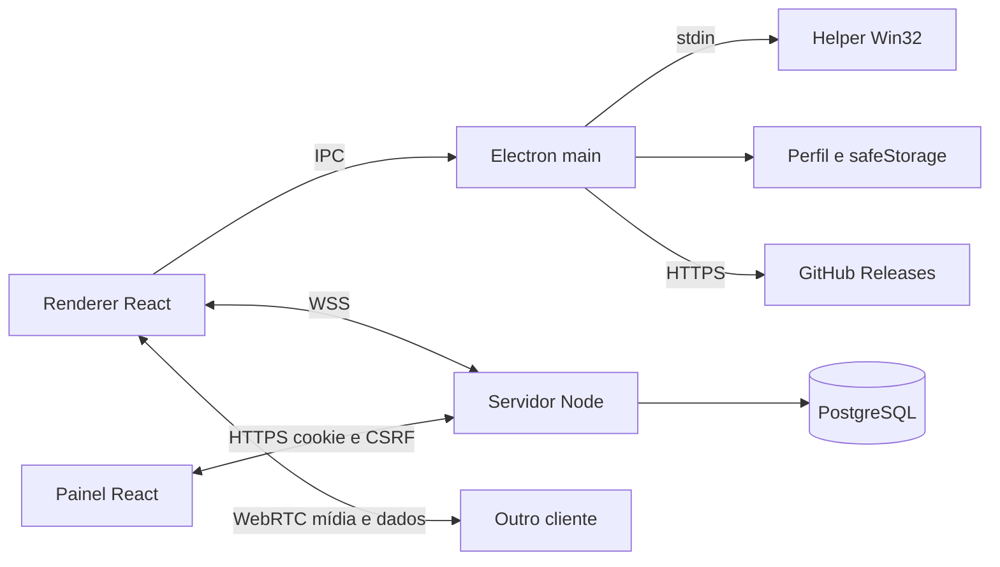

Auditoria local — 17/11/2026, commit 26cfb1b, versão 1.0.2, Windows x64. Sem alterações funcionais; não é certificação.

# Arquitetura atual

| Camada | Implementação | Estado real |
|---|---|---|
| Renderer | React/Vite; App e hooks Signaling/CallManager/WebRTCPeer | Fluxo ativo de sinalização, mídia e dados |
| Bridge | src/main/preload.ts e contextBridge | APIs específicas; também expõe contratos legados |
| Main | deviceSecurity, sessionAuthority, screenManager, inputManager, history, updater | Chave privada e recursos nativos; concessão de sessão recebida do renderer |
| Helper | CoffeeInput.cs + VirtualMouse.cs, stdin/stdout | Win32 real; mouse por mensagens e teclado no foco global |
| Servidor | server/admin/security/proxy/database | HTTP/WS autenticado; não encaminha mídia |
| Banco | PostgreSQL, migração 001 e runtimeRole | Identidades públicas, admins, denúncias, sanções e auditoria |
| Painel | admin-panel React | Mesmo serviço; login/TOTP/cookies/API reais |
| Distribuição | electron-builder NSIS + electron-updater | Windows real; DMG/AppImage configurados não comprovam suporte |

## Estado das funcionalidades

Implementadas com evidência local: identidade Ed25519, scrypt, TOTP, denúncias/sanções persistentes, captura de fonte real, WebRTC, mouse virtual, clipboard texto/arquivo, histórico por servidor, favoritos, bandeja. Atualização possui core/UI reais e testes simulados; upgrade real entre instaladores não foi validado nesta etapa.

Parciais: cancelamento/ACK de arquivos, continuidade sob falhas, autenticação da distribuição, defesa independente do main contra renderer adulterado, observabilidade e retenção. Configuração Mac/Linux existe, mas faltam adaptações/ensaios nativos. Android não existe.

Legado/simulação: connectionManager cria mapa placeholder; GET_SESSION_INFO retorna desconectado; captura WebRTC do main lança erro e não substitui getDisplayMedia real do renderer. Código legado de gravação não foi demonstrado alcançável pelo fluxo ativo; não classificá-lo como path traversal remoto sem provar reachability (CD-13).

## Acoplamento e qualidade

TypeScript strict e limites/validações são positivos. Contagem lexical no conjunto src/servidor/painel: 30 tokens any e dez catches vazios; são indicadores, não vulnerabilidades por si. ESLint permite any/catch vazio. Sessão depende de refs, estados, eventos globais window, IPC e mensagens assíncronas em diferentes módulos. Estilos inline continuam em UI antiga.

CD-01 é a fronteira principal: main conserva recursos nativos mas renderer fornece a afirmação de consentimento usada para autorizá-los. Proposta incremental: coordenador de sessão no main, adaptadores tipados para transporte/captura/entrada/arquivos, snapshots para UI e comandos de intenção. Consolidar contrato ativo, reduzir eventos globais e descontinuar APIs antigas com mapa de consumidores. Não reescrever aplicação inteira.

Fontes: src/main/index.ts, preload.ts, sessionAuthority.ts, connectionManager.ts, webrtcManager.ts; src/renderer/App.tsx e hooks; signaling-server/src/server.ts/admin.ts; electron-builder.json. Achados e aceite: SECURITY-AUDIT CD-01/CD-13.
