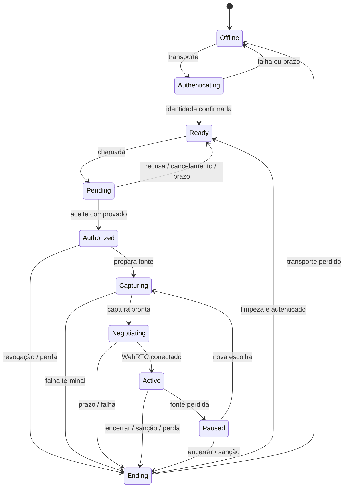

Auditoria local — 17/11/2026, commit 26cfb1b, versão 1.0.2, Windows x64. Sem alterações funcionais; não é certificação.

# Regras de negócio e estados

1. Inicialização: single-instance, main/preload/helper, janela/bandeja. App não inicia servidor público; endpoint vem do build privado.
2. Identidade: chave Ed25519 por servidor, privada safeStorage; hello/challenge/authenticate atribui ID pela chave pública.
3. Recuperação: reconexão prova posse da mesma chave; ID legado em store não autentica.
4. Chamada: nove dígitos, não próprio; servidor verifica presença/sanção/capacidade/ocupação e cria UUID/prazo.
5. Consentimento: modal com ID/fonte/recursos; manual inicia tudo marcado por decisão de produto. View-only desmarca. Monitor permite alternar monitores sem novo aceite; janela não concede isso.
6. Aceite: alvo responde, servidor confirma papéis/permissões/fonte aos dois. Hook entrega confirmação ao main (fronteira CD-01).
7. Captura: fonte real/getDisplayMedia, sem fallback virtual automático; fechamento/topologia alterada pausa e pede escolha.
8. Controle: apenas monitor com captura pronta e coordenadas físicas/bounds/letterbox; mouse virtual experimental separado do cursor, teclado usa foco do Windows.
9. Clipboard: permissão específica, automático por padrão, texto até 65.536 caracteres; arquivo exige ambas permissões, token e limites; recortar envia cópia sem apagar original.
10. Arquivos: 32 MiB cada, fila 64 MiB/20; recebimento dentro de autorização files. Cancelamento/ACK incompletos CD-07/08.
11. Acesso por senha: verificador scrypt main; novas ativações view-only/monitor principal; senha transita via WSS e servidor. Migração fraca desativa automático até troca.
12. Reconexão: backoff/jitter preserva identidade, mas encerra sessão em perda de sinalização e não retoma mídia automaticamente.
13. Encerramento: notifica servidor, limpa estado nativo, desmonta streams/canais; histórico de tentativa local por servidor.
14. Revogação: host reduz localmente e aguarda confirmação para concessão; admin sanciona, encerra chamada e notifica ambos. Oficial obedece, cliente adulterado P2P é limite.

Fontes: useCallManager.ts, useSignaling.ts, useWebRTCPeer.ts, useRemoteMonitors.ts, sessionAuthority.ts, server.ts.

## Máquina proposta para coordenador único

Proposta, não enumeração já implementada: hoje estados são refs/booleans nos hooks e pending/active no servidor. Invariantes: captura só após aceite; concessões comprovadas no main; janela sem controle; resposta assíncrona pertence à geração corrente; cancelamento/revogação termina transferência; entregue exige ACK. Testar cancelamento durante preparo e mensagens atrasadas/duplicadas.

Recentes/history active começam no aceite, não na primeira mídia conectada. Histórico local não é auditoria inviolável. Duração mede intervalo autorizado; decidir se produto quer tempo de mídia. Não inventar duração de legado/interrupção.
