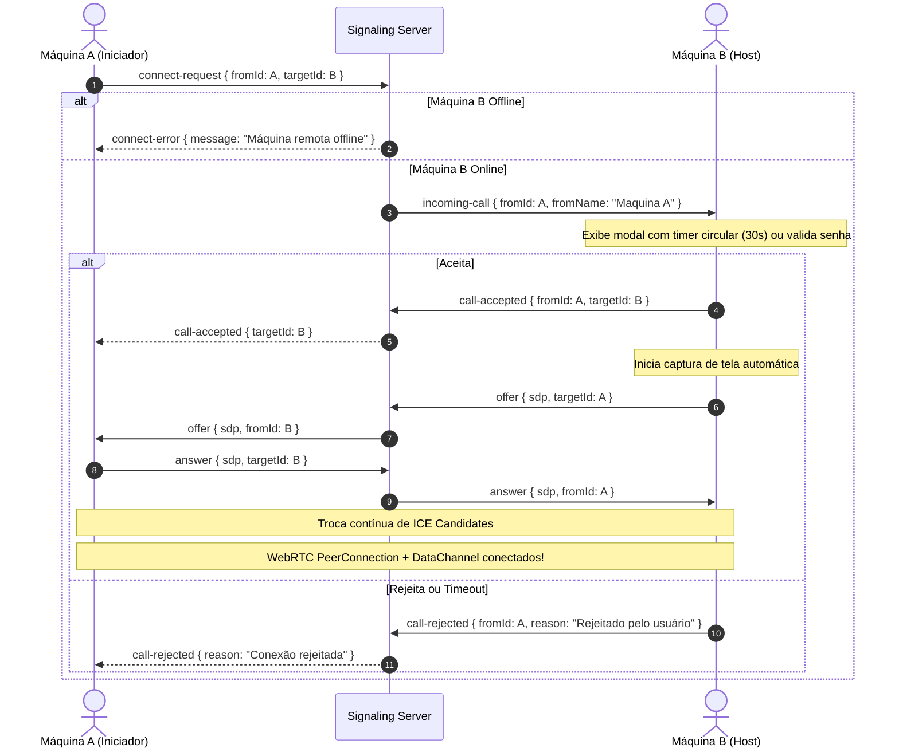

# Especificação de Design — Conexão P2P, UID Único e Interface Impeccable

**Data:** 2026-11-10  
**Status:** Aprovado via `/grill-me`  
**Alinhamento:** Superpowers & Impeccable (Craftsmanship UI)

---

## 1. Problema e Diagnóstico do Estado Atual

1. **Geração de UID**: O cliente gerava um número aleatório com `Math.random()` localmente sem validação central no servidor de sinalização, podendo gerar colisões e sem garantir registro de presença online.
2. **Servidor de Sinalização (`signaling-server`)**: Criava um UUID aleatório temporário para cada WebSocket (`uuidv4()`) e ignorava o `coffeeDeskId` de 9 dígitos. Máquinas não conseguiam se localizar mutuamente pelo ID da interface.
3. **WebRTC Incompleto**: Em `RemoteStreamView.tsx`, a troca de sinalização (`sendSignalingMessage`) realizava apenas `console.log`, sem encaminhar ofertas, respostas e candidatos ICE reais através do WebSocket do servidor de sinalização.
4. **Estados de Interface Faltantes**: Faltavam estados de feedback ricos (chamando máquina remota, modal de autorização de entrada na máquina host, feedback de timeout, aviso de servidor de sinalização offline).

---

## 2. Decisões Arquiteturais e Fluxos

### 2.1. Registro e Garantia de UID Único Centralizado
- O **Signaling Server** atua como autoridade para registro e unicidade dos IDs de 9 dígitos (`XXX-XXX-XXX`).
- Ao iniciar o aplicativo:
  1. O cliente conecta no WebSocket `ws://localhost:8080`.
  2. Envia mensagem `register` com seu `savedId` (caso já possua salvo no `electron-store`) ou solicita um novo ID.
  3. O servidor valida se o ID está livre:
     - Se o ID já existir para outro cliente conectado, gera um novo ID único de 9 dígitos e retorna.
     - Se o ID for válido, vincula o socket do cliente a este `coffeeDeskId`.
  4. O cliente recebe `{ type: 'registered', id: 'XXX-XXX-XXX' }` e atualiza seu estado e `electron-store`.
  5. Se o servidor de sinalização cair ou reiniciar, o cliente tenta reconectar automaticamente a cada 5 segundos.

### 2.2. Handshake de Conexão Entre 2 Máquinas (P2P Handshake)

### 2.3. Transmissão Automática de Tela e Controle
- A máquina Host (que está sendo acessada) captura automaticamente a tela principal via `desktopCapturer` no Electron e adiciona os tracks de vídeo ao `RTCPeerConnection`.
- Cria `RTCDataChannel` para envio de coordenadas de mouse, eventos de clique/scroll, teclas pressionadas, dados de clipboard e arquivos.
- A máquina que acessa renderiza o stream de vídeo em elemento `<video>` em baixa latência com controles de mouse/teclado mapeados.

### 2.4. Design Impeccable (Craftsmanship UI)
- **Status da Rede no Rodapé**:
  - `Online`: Ponto verde com pulso sutil e texto "Conectado ao servidor".
  - `Offline / Reconectando`: Ponto âmbar/amarelo piscante "Reconectando ao servidor em 3s...".
- **Botão de Conectar**:
  - Estado Idle: `⚡ Conectar →`.
  - Estado Chamando: Spinner âmbar suave giratório + texto "Chamando [ID]...".
  - Estado Aguardando: "Aguardando autorização...".
- **Modal de Chamada Recebida (Incoming Call Modal)**:
  - Estilo glassmorphism escuro com borda âmbar e brilho de alerta.
  - Avatar do solicitante + ID + barra/timer de 30 segundos.
  - Botão verde/âmbar "Aceitar e Compartilhar Tela" e botão vermelho "Recusar".
- **Modo de Acesso Não Supervisionado (Configurações)**:
  - Opção no modal de Configurações para definir senha de segurança.
  - Quando habilitado, conexões com a senha correta não precisam de confirmação manual.
